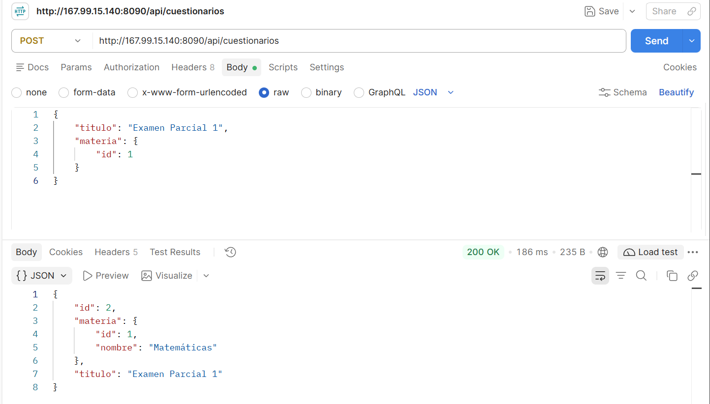
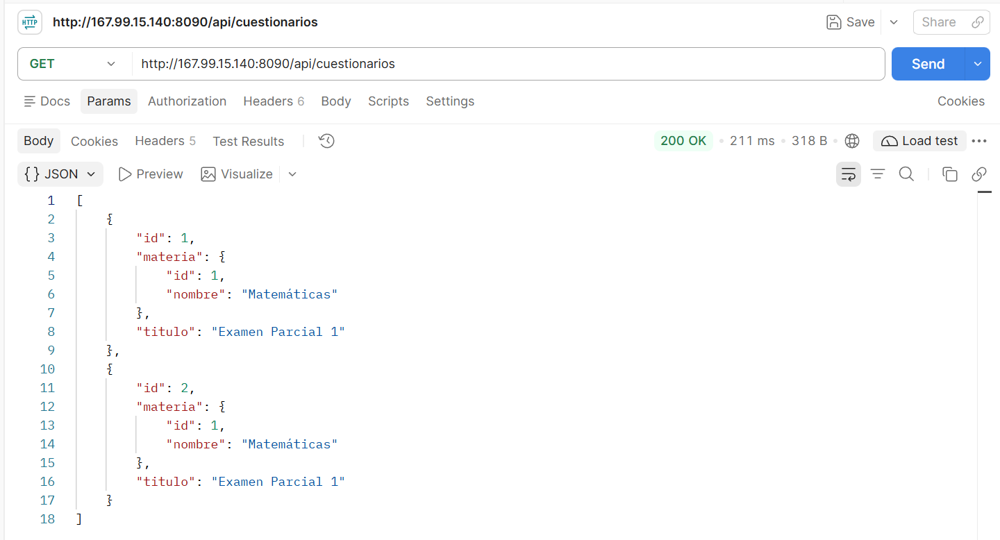
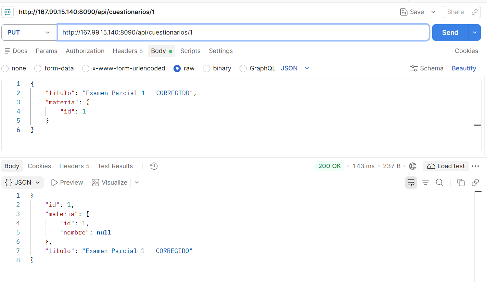
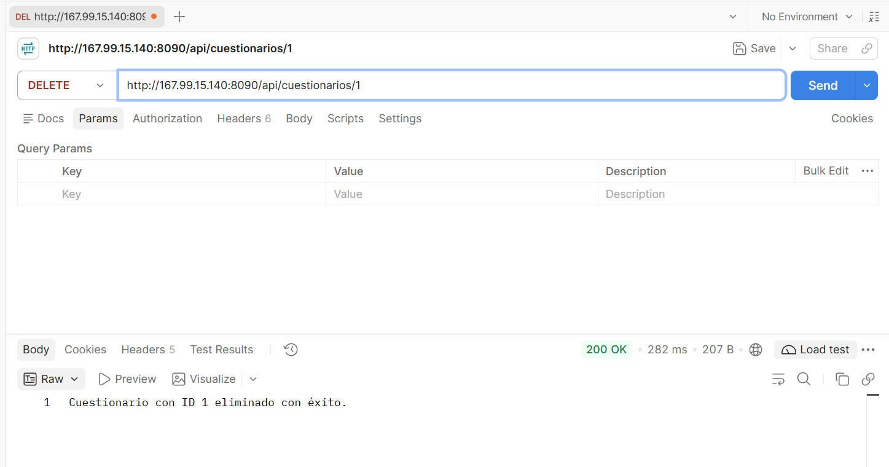

# Actividad 3: CRUD Spring Boot en VPS - Materias y Cuestionarios

Se implementa una API REST con Spring Boot, Spring Data JPA y MySQL.

## Entidades y Relación
Se implementó una relación bidireccional usando las anotaciones `@OneToMany` y `@ManyToOne`:
- **Materia (1):** Entidad principal, dueña de la relación inversa.
- **Cuestionario (N):** Entidad secundaria que contiene la llave foránea `materia_id`.

## Pruebas del CRUD en el VPS (Postman)

### 1. Crear (POST) - Demostración de la relación
Al crear un Cuestionario, se le asigna el ID de la Materia. La respuesta guarda el registro y anida los datos de la materia relacionada.

### 2. Leer (GET) - Relación reflejada correctamente
Al consultar los cuestionarios, se puede observar cómo la llave foránea se resuelve exitosamente, mostrando el nombre de la materia ("Matemáticas") y no solo su ID.

### 3. Actualizar (PUT)
Modificación exitosa de los datos de un cuestionario existente (cambio de título).

### 4. Eliminar (DELETE)
Eliminación exitosa del registro en la base de datos.

